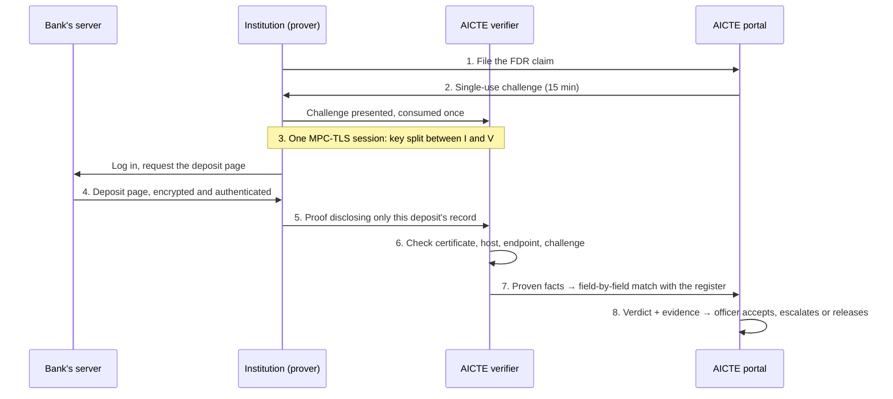

# Scourge: the idea, the solution and how it works

**Ask the bank, not the paper.** Smart India Hackathon 2026 · Problem statement **SIH26265**, *Streamline of Security Deposit / FDR Portal* (AICTE) · Team **Arnavax#** (ID 199322)

Demo video: https://youtu.be/8HoplhFOGCg · Idea deck: [`docs/ppt/Scourge_SIH26265_Idea.pdf`](ppt/Scourge_SIH26265_Idea.pdf)

> **In one sentence:** an institution proves, from its own net-banking session, what the bank's server says about its security-deposit FDR; AICTE's verifier checks the proof and sees only that one deposit's record, so a forged, edited or out-of-date FDR cannot pass.

The prototype's workflow runs against a **synthetic bank** with real cryptographic proofs. On 1 Nov 2026 the same split-key session ran live against a real bank's logged-in deposits API (first bank tested: SBI: certificate verified, HTTP 200 OK in 0.4 s, 61 MB). For banks that encrypt deposit data inside HTTPS, as SBI does, the in-browser prover reads the record with the page's own session key ([`EXTENSION_PROVER.md`](EXTENSION_PROVER.md)); signed e-advice and branch confirmation cover the rest ([`FEASIBILITY.md`](FEASIBILITY.md)). Scourge never marks a deposit Verified without a proof.

---

## Contents

0. [Scourge from zero, in five levels](#0-scourge-from-zero-in-five-levels)
1. [The problem](#1-the-problem-a-deposit-checked-once-trusted-for-ten-years)
2. [The idea](#2-the-idea-ask-the-bank-not-the-paper)
3. [The solution: three pieces of software](#3-the-solution-three-pieces-of-software)
4. [The workflow, solved as a case](#4-the-workflow-solving-a-case-in-eight-steps)
5. [The suspect fights back](#5-the-suspect-fights-back-every-trick-and-its-verdict)
6. [The four verdicts](#6-the-four-verdicts)
7. [The full FDR lifecycle in the portal](#7-the-full-fdr-lifecycle-in-the-portal)
8. [Proven today, and the next gate](#8-proven-today-and-the-next-gate)
9. [Why it is different](#9-why-it-is-different)
10. [Trust boundaries: what Scourge does and does not prove](#10-trust-boundaries-what-scourge-does-and-does-not-prove)
11. [Where to find things in this repo](#11-where-to-find-things-in-this-repo)

---

## 0. Scourge from zero, in five levels

Read only as far as you need; each level adds one idea.

**Level 1 · The story in one breath.** Every engineering college must keep some money in a bank as a safety deposit for its students. AICTE checks a paper that says "the money is there". Sometimes the paper lies. Scourge lets AICTE ask the bank directly instead of trusting the paper.

**Level 2 · Why the paper can lie.** The paper is made or handed over by the college. It can be forged, edited on a computer, or simply out of date: the money might have been withdrawn, or borrowed against, after the paper was printed. AICTE checks it once and then trusts it for up to ten years.

**Level 3 · Why not just ask the bank?** Asking every bank officially means letters, agreements or special bank software, for over a hundred banks. But every bank already shows the truth in one place: the college's own net-banking page. The catch: a screenshot of that page can be edited, so we would be back to trusting the college.

**Level 4 · The sealed envelope with two keys.** Think of the bank's page as a letter in a sealed envelope. Normally only the college holds the key, so it could also make a fake letter and seal it. Scourge cuts the key in two: the college holds one half, AICTE the other.

- The college cannot make a fake sealed letter: it has only half a key.
- AICTE cannot open the college's mail alone: it also has only half.
- The bank's real letter is opened together, and changing a single word breaks the seal.

The college may cover parts of the letter with black tape (other accounts, PAN), but cannot change what it shows. AICTE sees only the line about this one deposit.

**Level 5 · What really happens inside the computer.**

| Analogy | Real mechanism |
| --- | --- |
| The envelope | HTTPS (TLS), which every bank website already uses. Each response is encrypted and authenticated with a session key. |
| Cutting the key in two | MPC-TLS (multi-party computation over TLS, also called zkTLS). The institution's prover and AICTE's verifier jointly run the TLS client, so neither ever holds the whole session key. We use the open-source [TLSNotary](https://tlsnotary.org) library. |
| The black tape | Selective disclosure: the prover reveals chosen byte ranges of the transcript; AICTE learns only the length of what is hidden. |
| "Is it really the bank?" | The bank's X.509 certificate for its real hostname, checked against trusted roots, the same check behind the browser padlock. |
| No old letters | Each proof is bound to a fresh, single-use challenge from AICTE that expires in 15 minutes. |

---

## 1. The problem: a deposit checked once, trusted for ten years

AICTE requires every institution to keep a security deposit as an FDR held jointly with AICTE, to protect students if the institution shuts down or defaults. Today the proof is a document (a scanned FDR, a bank letter or a screenshot), checked once and then trusted for up to 10 years.

This is not hypothetical. In October 2026 a CBI chargesheet stated that ₹201.42 crore of FDRs "did not appear" in a bank's records, and CBI found AICTE joint FDRs encashed or loaned against without consent (sources in the deck, slide 6).

**Why better document checks cannot fix it.** OCR, QR codes or a blockchain hash of the uploaded file all check the *document*. The document is either genuine but out of date, or forged well. Only the bank knows the truth today.

### The case used in the rest of this file

All names and numbers are invented.

| | |
| --- | --- |
| Institution | Sri Sai Institute of Technology, Hyderabad, renewing its AICTE approval |
| Deposit | FD-777777 at a national bank, ₹25,00,000, maturing 15 Jan 2029 |
| What the paper says | Active, ₹25 lakh, held jointly with Member Secretary AICTE, no lien |
| What is really true | Six months ago the college took a ₹21,25,000 loan against this FD |
| What AICTE must decide | Is the deposit really there, untouched, before approval or release? |

**Today:** Sri Sai uploads a crisp PDF of its original FDR. It looks perfect; the officer approves it. The loan, taken after the paper was printed, is found years later at release time, or never.

---

## 2. The idea: ask the bank, not the paper

If AICTE can trust the institution's own net-banking page, it needs no bank API, no agreement with any bank and no Account Aggregator licence, and it covers every FDR already on the books. Splitting the TLS session key between the institution and AICTE (Level 4 and 5 above) is what makes that page trustworthy to AICTE.

**In the case:** Sri Sai can no longer show AICTE a document it made. It has to show the page the bank's server sends right now, and that page includes the loan.

---

## 3. The solution: three pieces of software

The bank installs nothing and changes nothing.

| Piece | Runs where | Job | Code |
| --- | --- | --- | --- |
| **Scourge portal** | AICTE's server | FDR register, challenges, policy match, verdicts, evidence view, lifecycle monitoring, audit log, release gate | `app/` (Python, FastAPI, SQLite) |
| **Scourge prover** | The institution's computer (in the demo: on the demo server) | Logs into the institution's net banking, holds one half of the session key, chooses what to disclose | `rust/prove.rs` → `bin/scourge_prove` |
| **Scourge verifier** | AICTE's server, a separate process | Holds the other half of the key, checks certificate, host, endpoint and challenge, extracts proven fields, posts facts to the portal | `rust/verifierd.rs`, `rust/common.rs` → `bin/scourge_verifierd` |
| Mock bank (demo only) | Local | A synthetic bank with a test certificate authority, plus a fake bank and an unapproved bank for attack demos | `rust/mockbank.rs` → `bin/scourge_mockbank` |

**What crosses to AICTE:** the bank's hostname and certificate, the request line (method and approved path), the HTTP status, and the one deposit's record.
**What stays with the institution:** password, OTP, cookies and session headers, the query string, PAN, every other account, and its own full copy of the page.

---

## 4. The workflow: solving a case in eight steps

| Step | What happens | In the case |
| --- | --- | --- |
| **1. File the FDR** | The institution files its claim in the portal: bank, FD number, amount, issue and maturity dates. The server pins it to the signed-in institution. An officer can also enter one from a paper submission. | Sri Sai files FD-777777, ₹25,00,000, maturing 15 Jan 2029. The register holds the paper's version of the truth. |
| **2. Challenge** | When AICTE wants to check (approval, a random audit, every 30 days, or before release), the portal issues a challenge bound to this FDR and institution, valid 15 minutes, usable once. | The officer clicks *Request bank proof*; Sri Sai's dashboard shows "Prove FD-777777 from your bank's own server". |
| **3. Log in, key split** | The institution runs the prover and logs into its own net banking. The prover first presents the challenge to the verifier, which consumes it; then the TLS session key is created jointly by prover and verifier. The bank sees an ordinary login. | The accountant types the usual user ID, password and OTP. They never leave the college's computer. |
| **4. Bank sends the page** | The bank returns the deposit page, encrypted and authenticated under the split key. Neither side can alter it without breaking the proof. | The page says: Active · ₹25,00,000 · holders Sri Sai Trust / Member Secretary AICTE · **Lien: LOAN ₹21,25,000 AGAINST DEPOSIT**. |
| **5. Disclose one record** | The prover reveals the request line, status line and the deposit's record only. It refuses to disclose a body that lists several deposits. | PAN, savings balance and other accounts stay hidden. The lien line is part of the record, so it is shown. |
| **6. Verifier checks** | Certificate chain and hostname, approved bank, same bank as registered, approved endpoint, FD number equals the challenged one, record unambiguous. | The certificate is the bank's, the challenge is fresh, the FD number matches. |
| **7. Match the register** | The portal compares status, balance, principal, maturity, holders and lien with the claim, each linked to the exact bank bytes. | Lien: paper says "in favour of AICTE only", bank says "LOAN ₹21,25,000 AGAINST DEPOSIT" → **mismatch**. |
| **8. Officer acts** | One verdict with evidence. The officer accepts, escalates or asks again. Every step is in the audit log. Release needs an accepted bank confirmation from the last 30 days. | **Discrepancy: the bank's server contradicts the paper.** The officer escalates; release stays blocked. Solved in minutes, not years. |

---

## 5. The suspect fights back: every trick and its verdict

| Sri Sai tries to… | What Scourge sees | Verdict |
| --- | --- | --- |
| Upload the PDF again instead of proving | Only a picture; no bank proof | Stays *paper only* |
| Edit the bank page in the browser first | The proof covers the bank's bytes, not the screen | Discrepancy, unchanged |
| Run a fake "bank" site that shows no loan | It cannot present the bank's genuine certificate | Rejected |
| Use a real but unapproved bank, or a different bank | Host not on AICTE's list, or not the registered bank | Rejected |
| Reuse a clean proof from before the loan | Challenge expired or already consumed | Rejected |
| Hide the lien line, or withhold part of the record | Required field missing / partial disclosure | Insufficient evidence |
| Prove a different, clean FD | FD number differs from the challenged one | Rejected |

If a bank's page never shows a required field (often the lien), the institution uploads a **bank-signed e-advice** (built: `app/eadvice.py`). Scourge verifies the signing certificate against trusted bank roots, the bank host, the signature over the canonical payload, the FD number and that it is under 30 days old, then uses it for the missing fields only. An edited or self-signed e-advice is rejected; one that shows a loan makes the result a Discrepancy. It never guesses, and it never says Verified on incomplete evidence.

---

## 6. The four verdicts

| Verdict | When | Officer action |
| --- | --- | --- |
| **Verified** | Every required field proven and matching | Accept; the deposit is confirmed for 30 days |
| **Discrepancy** | The bank proves something that contradicts the register (loan, closure, lower balance, wrong maturity, AICTE not a holder) | Escalate; release blocked |
| **Insufficient evidence** | A required field is missing, unrecognised or withheld | Ask for a fresh proof or a field-specific bank letter |
| **Rejected** | The proof is invalid: wrong host, bad certificate, wrong endpoint, wrong FD, expired or reused challenge | Reject and log |

A proven contradiction outranks an unknown elsewhere. Decision rules: `app/policy.py`.

---

## 7. The full FDR lifecycle in the portal

| Stage | In the prototype |
| --- | --- |
| **1 File** | Institutions file their own FDRs (`/fdrs/new`); officers can enter paper submissions; a renewed FDR is linked to the one it replaces, and the old one counts as renewed once the bank confirms the new one |
| **2 Prove** | Single-use challenge → bank-session proof → verdict with byte-level evidence |
| **3 Monitor** | **Deposit adequacy** vs AICTE APH 2024-27 Table 1.4 (`config/deposit_rules.json`; ×2 for leased land; Government exempt) with filed vs bank-confirmed amounts and 10-year **term gaps** (`/institutions`); **daily reminder and escalation ladder** (T-90/60/30/7; matured & unrenewed → scrutiny officer, regional head after 7 days, competent authority after 21) written to an in-app + e-mail outbox (`/notifications`; demo time machine "run as of"); register "Needs attention" panel: bank contradicts paper, matured not released, maturing within 90 days, re-check due, deposit shortfall, term shorter than 10 years |
| **4 Decide** | Officer accept / escalate; evidence exportable as JSON; audit log that is append-only **and hash-chained** (each entry carries the SHA-256 of the previous one; the Audit page re-verifies the whole chain and pinpoints the first altered entry; CSV export includes the hashes) |
| **5 Pledge release** | **Maker-checker** (proposer ≠ approver) + **department clearances** (Public Grievance Redressal Cell, Vigilance, Finance and Grants; an objection blocks) + **second signer** (RB-03) for deposits ≥ ₹1 crore; approval only with a current (<30-day) accepted bank confirmation and no **regulatory hold**; issues a release letter with audit-entry hash, **AICTE Ed25519 signature** and a **QR code** opening the public `/verify` page (or offline check with `/api/aicte-release-key`) |

---

## 8. Proven today, and the next gate

| Measure | Result | Scope |
| --- | --- | --- |
| Time per bank proof | 0.58 s, median of 60 runs | Measured, synthetic bank on one server |
| Data per proof | about 39 MB between prover and verifier | Measured |
| Bad deposits caught | 119 / 119 (an upload-and-approve baseline approved all 119) | Measured, 180 fresh synthetic deposits |
| Honest deposits wrongly accused | 0 / 61 | Measured, same run |
| Automated tests | 276 pass (273 demo mode + 3 production sign-in mode), 2 deployment-only skipped | Local run, 1 Nov 2026 |
| Real TLS sessions | 13 / 16 public pages at 6 Indian banks | Measured; public pages |
| Live real-bank MPC-TLS session | Logged-in deposits API, HTTP 200 OK in 0.4 s, 61 MB (first bank tested: SBI) | Measured |
| Software licence cost | ₹0 | Estimate |

**Next:** the in-browser prover reads deposit records at app-encrypted banks (its verifier→portal bridge is built and tested); a survey of which banks show liens and joint holders; bank terms and AICTE acceptance through legal review.

---

## 9. Why it is different

Scourge is the only approach in this comparison that uses the bank's own data without needing anything from the bank.

| Approach | Bank's own data | Needs nothing from the bank | Institution cannot forge | Covers existing FDR book |
| --- | --- | --- | --- | --- |
| Upload, OCR or officer checklist | No | Yes | No | Yes |
| Blockchain hash of the upload | No | Yes | No | Yes |
| Simulated bank API / CBS / SFMS | Yes | No, banks must build it | Yes | Only once banks join |
| Account Aggregator | Yes | No, needs a regulated FIU licence | Yes | Partly |
| NeSL e-BG | Yes | No | Yes | No, new instruments only |
| **Scourge** | **Yes** | **Yes** | **Yes** | **Yes** |

The technique (MPC-TLS / zkTLS) is established; our contribution is applying it to AICTE deposits with a register match, honest verdicts, selective disclosure and a full deposit lifecycle. A sensible rollout pairs NeSL e-BG for new deposits with Scourge for the existing FDR book.

---

## 10. Trust boundaries: what Scourge does and does not prove

**Proves:** that specific bytes were sent by the server holding the bank's genuine certificate, in a session that started after AICTE's fresh challenge, and that the disclosed record says what the portal shows.

**Does not prove:**

- that the bank's own database is correct (insider fraud at the bank is out of scope);
- fields the bank's page does not show (reported as Insufficient evidence, never guessed);
- workflow results use the synthetic bank; on a real bank the split-key session runs against the logged-in deposits API, and app-encrypted records are read by the in-browser prover;
- in the demo, the prover runs on the demo server so judges can click through; in deployment it runs on the institution's computer.

Further detail: `docs/AUDIT.md` (security review), `docs/VERIFICATION.md` and `docs/PHASE4_VERIFICATION.md` (evidence), `docs/RUNBOOK.md` (operations), `docs/JUDGE_DEMO.md` (click-through script).

---

## 11. Where to find things in this repo

| Path | What |
| --- | --- |
| `app/` | Portal: routes (`main.py`), decision policy (`policy.py`), auth, DB, templates |
| `rust/` | Prover, verifier, mock bank and shared proof checks (TLSNotary pinned in `TLSN_COMMIT.txt`) |
| `bin/` | Prebuilt Linux x86_64 binaries with `SHA256SUMS` |
| `config/` | Approved banks, field schemas, demo settings |
| `certs/` | **Synthetic** test certificates and keys, published on purpose (see `certs/README.md`) |
| `tests/` | Acceptance, UI journey and adversarial tests |
| `docs/` | This file, the idea deck, demo video, audit and verification reports |
| `scripts/run.sh` | Starts everything on 127.0.0.1:8080 |
